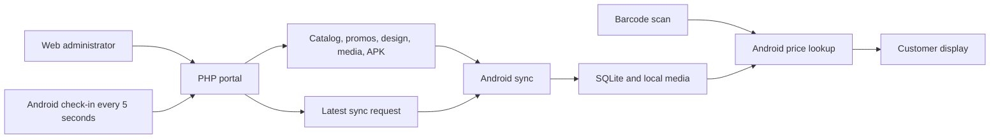

# Project analysis

Reviewed on 2026-10-02. This is a source and configuration review, with Android build and portal syntax checks. No application behavior or server configuration was changed.

## Source locations and baseline

- Android source: `app/src/main/java/com/priceverifier/`, with layouts and styling in `app/src/main/res/`.
- Portal source found at `C:\price verifier server - temporaryrename`. The expected folder `C:\price verifier server` is absent.
- Workspace portal copies: `server-installer/dist/stage/PriceVerifierServer-Windows-1.0.0/files/portal/`, the corresponding Linux stage folder, and the extracted Windows package under `server-installer/dist/PriceVerifierServer-Windows-1.0.0/`.
- All four `index.php` files have the same SHA-256: `ED5237C28BF1F45D98D5B34A6D4760258471E7582FB9E4EB597772DC3996EBA2`.
- The external portal's `assets/app.js`, `assets/app.css`, `.htaccess`, and `.user.ini` also match the staged Windows package. Its `README-client-upload.txt` differs.
- `server-installer/build-package.ps1` defaults to the absent original portal folder. A future packaging run needs the actual source path passed through `-PortalSource`, or an updated default.
- Backups under `backups/` are historical snapshots, not build inputs.
- Git reports the project files as untracked. There is no tracked baseline for reviewing edits to these files yet.

The external portal is outside this workspace's writable root. It can be reviewed here; future edits there are subject to filesystem approval. A portal source folder inside the project would make code changes and packaging easier to maintain.

## Architecture

The Android terminal performs price lookups against its own SQLite database. The web portal manages the files that terminals download. Scanning a product does not require a live server request.

### Android

Native Java app, without a web frontend or JavaScript framework. It uses Android Gradle Plugin 8.13.2, Gradle 8.14.5, Android SDK 36, minimum Android SDK 23, and the Datalogic Android SDK 1.49. The configured app version is `v6`, version code 6.

| File | Responsibility |
| --- | --- |
| `MainActivity.java` | Scanner keyboard and intent input, customer display, idle media playback, scheduling, remote requests, update prompts |
| `AdminActivity.java` | PIN access, import, manual items, synchronization, local display settings and media administration |
| `ProductListActivity.java` | Local product search, pagination, edits and deletion |
| `ProductDatabase.java` | SQLite schema version 6, products, import history, promotions and staged catalog replacement |
| `ProductImporter.java` | Streaming CSV/TXT parsing, header aliases and price conversion |
| `Product.java` | Barcode normalization and lookup variants, including UPC/EAN reconciliation |
| `LanSync.java` | Catalog, promotions, images, videos, marquee, media ordering and design downloads |
| `RemoteSync.java` | Device check-in, remote request parsing and completion reports |
| `ServerDesign.java` | Applies settings present in the server's design file |
| `AppSettings.java` | Local preferences, media paths and download timestamps |
| `DeviceAccess.java` | Hardware serial detection and compiled device allowlist |
| `AppUpdate.java`, `UpdateApkProvider.java` | APK discovery, download and access for Android's installer |

Prices are stored as integer cents. Display currency is fixed to Philippine pesos in `PriceFormatter.java`.

### Web portal

Plain PHP with vanilla JavaScript and CSS. `index.php` contains request handling, authentication, file conversion, catalog operations and HTML rendering. There is no server SQL database in the reviewed portal; persistent content is stored in files.

The portal has six tabs: Display media, Catalog, Promos, Design, App update and Scanners. It supports CSV/TXT/XLSX/XLS catalog uploads, replacement or merge by barcode, custom column aliases, individual item edits, scheduled media, playback order, promotions and common display settings.

The existing external catalog is approximately 20.7 MB. Search scans the CSV to compute matches and pagination; a single item edit rewrites the catalog. Merge uploads retain incoming products in a PHP array while streaming the existing file.

Browser administration uses a password hash, sessions, regenerated session IDs on authentication, CSRF tokens and escaped HTML output. Scanner endpoints and downloadable content are available without the browser administration session.

### Server packages

| Target | Runtime and lifecycle |
| --- | --- |
| Windows | Caddy serves files and forwards PHP requests to four PHP FastCGI workers on localhost ports 9101-9104. A PowerShell supervisor restarts processes. Task Scheduler starts the supervisor as SYSTEM at boot. Default installation: `C:\PriceVerifier`; default public port: 8000. |
| Linux | FrankenPHP/Caddy runs under systemd as `priceverifier`, with service restart and filesystem restrictions. Default installation: `/opt/price-verifier`. |
| cPanel/Apache | The portal files can also be deployed to a hosted folder using `.htaccess` and `.user.ini`. |

The offline installers include runtimes, preserve portal data on upgrade, and configure LAN address restrictions. Caddy serves catalog and media downloads directly. The Windows installer has a test harness, but real Task Scheduler registration, firewall changes and runtime installation require separate machine-level verification.

## App/server contract

| Resource | Purpose |
| --- | --- |
| `catalog.csv`, fallback `catalog.txt` | Product catalog; required fields are barcode, name and price; optional fields are UOM, category and item code |
| `promos.csv` | Server promotions; stored separately from device promotions |
| `design.json` | Server-managed display settings; keys present override local values on every sync scope |
| `logo.png/jpg`, `banner.jpg/png`, `video.mp4` | Default idle display content |
| `marquee.txt` | Scrolling message; an empty file clears the message |
| `index.php?media_manifest=1` | Scheduled media inventory; file fallback is `media-manifest.txt` |
| `index.php?media_order=1` | Playback order; file fallback is `media-order.txt` |
| `index.php?device_poll=1` | Check-in, latest remote request and completion reporting |
| `index.php?app_update=1`, `price-verifier.apk` | Update metadata and APK download |

The app checks in every five seconds. The portal normally marks such a device offline after three missed intervals. Remote requests support items, images, videos, app update or everything. The portal stores one latest request shared by the scanners, rather than a per-device command queue.

The app uses `Last-Modified`/`If-Modified-Since` to skip unchanged files. Catalog downloads are streamed to a temporary file and checked for incomplete content before import. Optional media downloads use an in-memory byte buffer. The app limits catalog/media downloads to 100 MB, while portal upload settings permit individual files up to 128 MB.

## Findings relevant to modifications

These are source observations and expected consequences; the failure scenarios have not been reproduced on a running terminal or server.

1. **An import replaces the Android catalog.** `ProductImporter.importIntoDatabase()` uses a staging table and `ProductDatabase.StagedImportSession.finish()` swaps that table into place. Products absent from the imported file disappear, including locally added items. Portal merge mode combines records on the server before the resulting complete catalog reaches Android. The README's description of an upsert import does not fully describe this behavior.

2. **Zero valid imported rows can clear the local catalog.** The staging finish method has no minimum-valid-row guard. A header-only file, an empty manual import, or a correctly headed file containing only invalid products can replace the current products table with an empty table. The portal upload path rejects zero-valid-product uploads, but Android imports lack that protection.

3. **A failed daily sync is considered attempted for the day.** `MainActivity.runAutoSync()` sets the last daily-sync date before its network work, then ignores exceptions. `isDailyAutoSyncDue()` sees that date and will not schedule another daily attempt that day. Remote or manual sync can still be requested.

4. **Catalog writes have no shared writer lock.** Item mutations and catalog replacement stage files and rename them, but do not hold a common lock across reading and writing. Separate administration sessions can read the same catalog and overwrite each other's changes. File staging protects against publishing a partially written file, but does not resolve concurrent writers. Scanner state does use file locks.

5. **Large-catalog operations scale with file size.** Search and page loads scan the CSV; item edits rewrite it. Merge uploads store all incoming products in memory. This is relevant to server performance and the configured 256 MB PHP memory limit. No performance benchmark was run.

6. **Media failures can be hidden by an overall successful sync.** Optional download errors can leave old media in place, while another successful server response permits `LanSync.run()` to update the last-sync time and return normally. Remote completion reports can therefore show success without every requested asset having updated.

7. **Large video uploads can exceed the app's download limit or strain memory.** The 128 MB server upload limit is higher than Android's 100 MB media limit. Media downloads buffer the complete content, then obtain a byte-array copy; this deserves device testing if larger video support is requested.

8. **Device status is identified by serial, without endpoint authentication.** `outputDevicePoll()` checks serial syntax but does not authenticate the terminal or validate its serial against the Android allowlist. A caller able to reach the endpoint can submit a check-in or completion under an arbitrary valid serial. The compiled Android allowlist controls app use, not server endpoint identity.

9. **The PIN documentation differs from the UI.** The app defaults to `1234`, but `showSecurityModule()` disables the PIN field and Save button. The README tells administrators to change the PIN before deployment, which the current screen does not permit.

10. **Update discovery depends on timestamps.** `AppUpdate.check()` compares the APK modification timestamp against Android's installation time, with a grace period. The displayed version is not used as a version-code comparison. Correct clock and publication metadata matter for update visibility.

11. **Remote requests are replaced by newer requests.** Making a second portal request overwrites the single current request. A device that has not yet polled can miss the earlier one. This matters if future modifications require queued work or individual scanner targeting.

## Verification and limits

- `gradlew.bat assembleDebug --offline`: passed; all tasks were up to date. This confirms the current build succeeds using cached dependencies and outputs, not a clean rebuild.
- `php -l` on the external portal's `index.php`: passed.
- `node.exe --check` on the external portal's `assets/app.js`: passed.
- `app/src` contains only `main`; no Android unit-test or instrumentation-test source folders were found.
- No installer execution, uploads, catalog changes, authentication flows or device sync were exercised.
- The expected installed Windows portal folder `C:\PriceVerifier\portal` was absent. Listening-port inspection was denied by the environment, so live server availability, active runtime and LAN connectivity remain unverified.

## Modification map

| Requested area | Main files and dependencies |
| --- | --- |
| Customer screen or idle playback | Android `MainActivity.java`, layout XML, dimensions and drawable resources |
| Web portal appearance and interactions | Portal `assets/app.css`, `assets/app.js`, HTML in `index.php` |
| Catalog fields, import or barcode matching | Portal catalog helpers; Android `Product`, `ProductImporter`, `ProductDatabase`; migrations when persistence changes |
| Promotions | Portal promotion helpers; Android `Promo`, `PromoImporter`, `PromoEditor`, database and display logic |
| Remote synchronization | Portal device state/request helpers; Android `RemoteSync`, `MainActivity`, `LanSync` |
| Shared display settings | Portal design field definitions; Android `ServerDesign` and `AppSettings` |
| APK distribution | Portal update metadata; Android `AppUpdate` and installer flow; version and signing configuration |
| Installation or service behavior | `server-installer/windows/`, `server-installer/linux/`, package builder and installer harness |

For future changes, preserve the file formats and endpoint compatibility unless both portal and Android are deliberately updated together. Establish a tracked source baseline and select the portal source location before preparing a distributable package.
